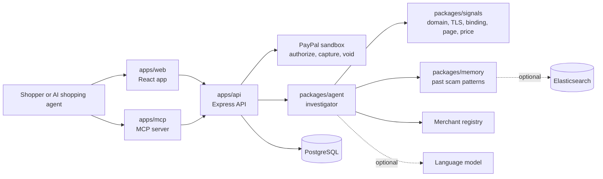

# TrustOra

TrustOra checks who is really getting paid before a PayPal payment is captured.

## The problem

A shopper sees a checkout page that claims to be one merchant, but the PayPal account that
receives the money belongs to someone else. A fake outlet can copy a brand's look, undercut its
price and route the payment to a personal account. A fraud score on the page alone does not catch
that, and an AI shopping agent that reads the page can be talked into paying by text hidden in it.

TrustOra connects the two sides: the merchant the storefront **claims** to be, and the **actual
payee** on the PayPal order.

## How it works

1. **Authorize.** The API creates the PayPal order with intent `AUTHORIZE`, so the money is held
   rather than taken (`apps/api/src/controllers/frontendApi.controller.ts`).
2. **Investigate.** The investigator agent (`packages/agent`) gathers evidence: domain age and
   certificate, whether the site publishes its payee ("payee binding"), a lookalike check against
   known brands, price against comparable sellers, the registry record of the payee, how the
   claimed name compares with the registered name, and past scam patterns from memory.
3. **Decide.** Evidence is scored on four weighted buckets (domain 30, merchant identity 40,
   pricing 20, technical 10) and turned into a decision:

   | Score | Decision | Meaning |
   | --- | --- | --- |
   | 0 to 39 | ALLOW | Eligible for capture |
   | 40 to 74 | WARN | Held until a person confirms |
   | 75 to 100 | PAUSE | Capture is blocked |

   (`packages/agent/src/scoring/decide.ts`.) The web app shows PAUSE as "BLOCK".
4. **Capture or void.** In the web flow only an ALLOW reaches capture; WARN and PAUSE are held,
   and a held order can be cancelled, which voids the authorization. On the agent routes a person
   can approve a WARN, but the code never captures a PAUSE decision.

**Hard rules the language model cannot override** (`packages/agent/src/scoring/rules.ts`):

- The site publishes a merchant id that differs from the PayPal payee: score floor 75, so PAUSE.
- The domain imitates a known brand and the payee is not linked to that brand: score floor 75.
- Hidden text on the page tries to instruct an AI assistant: score floor 40.

Hard rules need deterministic evidence. Anything written by a language model can raise suspicion
but cannot reach PAUSE on its own, and page text is treated as untrusted data throughout. A
language model only writes plain-language explanations and helps compare names; every step has a
deterministic fallback.

## Architecture



## Repository layout

| Path | What it is |
| --- | --- |
| `apps/api` | Express API: PayPal orders, the demo routes the web app calls, the agent routes the MCP server calls, migrations |
| `apps/web` | React app: storefronts, checkout, the investigation view, analyst console |
| `apps/mcp` | MCP server with the tools `investigate_merchant`, `safe_checkout`, `set_spend_policy`, and a demo shopping agent |
| `packages/contracts` | Shared types and constants |
| `packages/agent` | Investigator agent: scoring, hard rules, identity matching, explanations, memory use |
| `packages/signals` | Evidence collectors and an in-process signals port for the agent |
| `packages/memory` | Anonymous memory of past scam patterns (in memory or Elasticsearch) |
| `packages/eval` | Benchmark and metrics |
| `demo-sites`, `tests`, `infra`, `scripts`, `docs` | Fictional demo notes, shared fixtures, deployment, repo checks, documentation |

## Quick start

You need Node 22.

```bash
npm ci
npm run build
```

### Demo mode (no accounts, no database)

```bash
# API: runs without PayPal credentials or a database (investigations are kept in memory)
npm start

# Web app, in a second terminal. With VITE_USE_MOCK=true it uses its built-in simulated backend.
cp apps/web/.env.example apps/web/.env
npm run dev:web      # http://localhost:5173
```

Open `/stores` and buy from each of the three demo storefronts: the genuine one is captured, the
heavy-discount one is held for review, and the impersonator is paused. `/analyst` is the live
console. To make the web app call the API instead of its simulator, set `VITE_USE_MOCK=false` and
`VITE_API_TARGET=http://localhost:3000` in `apps/web/.env`.

### With a database

```bash
cp .env.example .env     # set DATABASE_URL, then PAYPAL_CLIENT_ID and PAYPAL_CLIENT_SECRET for the sandbox
npm run migrate
npm start
```

Deployment on Render is described in `docs/deploy.md`.

## Environment variables

Names only; values never belong in the repository. See `.env.example` and `apps/web/.env.example`.

| Variable | Read in |
| --- | --- |
| `NODE_ENV`, `HOST`, `PORT`, `CORS_ORIGIN`, `RATE_LIMIT_WINDOW_MS`, `RATE_LIMIT_MAX` | `apps/api/src/config/env.ts` |
| `DATABASE_URL`, `DATABASE_SSL`, `DATABASE_TIMEOUT_MS`, `DATABASE_MAX_CONNECTIONS` | `apps/api/src/config/env.ts` |
| `PAYPAL_MODE`, `PAYPAL_CLIENT_ID`, `PAYPAL_CLIENT_SECRET`, `PAYPAL_TIMEOUT_MS` | `apps/api/src/config/env.ts` |
| `AGENT_TIMEOUT_MS`, `AGENT_MAX_FOLLOWUPS`, `AGENT_CONF_THRESHOLD`, `FEATURE_*`, `MEMORY_MATCH_MIN` | `packages/agent/src/config.ts` |
| `LLM_PROVIDER`, `LLM_API_KEY`, `LLM_BASE_URL`, `LLM_MODEL_FAST`, `LLM_MODEL_STRONG`, `LLM_MODE`, `LLM_FIXTURE_DIR` | `packages/agent/src/config.ts` |
| `SIGNALS_MODE`, `SIGNALS_BASE_URL`, `SIGNALS_FIXTURE_DIR` | `packages/agent/src/config.ts` |
| `ELASTIC_URL`, `ELASTIC_API_KEY`, `ELASTIC_INDEX`, `ELASTIC_INFERENCE_ID` | `packages/agent/src/config.ts`; `ELASTIC_NODE` also in `packages/memory/src/store/factory.ts` |
| `MCP_TRANSPORT`, `MCP_PORT`, `MCP_BEARER_TOKEN`, `GUARDIAN_API_URL`, `GUARDIAN_API_KEY`, `GUARDIAN_REQUEST_TIMEOUT_MS`, `GUARDIAN_FINALIZE_TIMEOUT_MS` | `apps/mcp/src/config.ts` |
| `CHANNEL3_API_KEY`, `CHANNEL3_BASE_URL`, `LLM_*` | `apps/mcp/demo-agent` |
| `VITE_API_URL`, `VITE_USE_MOCK` | `apps/web/src/api/apiClient.ts` |
| `VITE_PAYPAL_CLIENT_ID` | `apps/web/src/hooks/usePaypalAuth.ts` |
| `VITE_API_TARGET` | `apps/web/vite.config.ts` (local dev proxy) |

## Tests

| Command | What it runs |
| --- | --- |
| `npm run test:integration` | API tests with mocked PayPal (no network, no credentials) |
| `npm run test:contracts` | Contracts type check and fixture validation |
| `npm run test:agent` | Investigator agent |
| `npm run test:mcp` | MCP server |
| `npm test -w @checkout-guardian/signals` | Signals package (also `-w @checkout-guardian/memory`, `-w @checkout-guardian/eval`) |
| `npm run test:sandbox` | Real PayPal sandbox calls. Needs credentials; skips without them |
| `npm run check:brands`, `npm run check:hygiene` | Fictional-brand guard and repository checks |
| `npm run lint`, `npm run typecheck` | Lint and type check |

## Evaluation

`npm run eval -w @checkout-guardian/eval` compares two baselines with the full agent on a
labelled benchmark and writes `docs/eval-results.md`. It is a small synthetic benchmark written by
the team, not a claim about real-world accuracy.

## What is real and what is simulated in the demo

Real: the API and its routes; the investigator agent's scoring, hard rules and explanation
checks, which run on every scan and order; the in-process scam-pattern memory; the rule that, in the web flow, only
an ALLOW reaches capture (the agent routes also let a person approve a WARN); and calls to the PayPal sandbox when sandbox credentials are set.

Simulated (read from `apps/api/src/services/agent/agentRunner.service.ts`):

- The three demo storefronts are decided from the agent's recorded scenarios, not from live
  signals. The numbers on the evidence cards (domain age, registry records, price benchmark,
  payee details) come from fixed profiles.
- Unknown domains are classified partly by keywords in the name.
- With no PayPal credentials, order ids and capture results are generated locally.
- Merchant reports, merchant registration and spend policies answer without storing anything.
- Investigations are kept in the API's memory, not in the database.
- Capture and void are sent with the order id; PayPal's AUTHORIZE flow needs the authorization
  id. The team is tracking this.

Hosted demo: TO BE ADDED after deployment

## AI tools and services used

Runtime components that exist in the code:

| Component | Where | Use |
| --- | --- | --- |
| Language model through an OpenAI-compatible HTTP provider (`LLM_PROVIDER`, `LLM_BASE_URL`, `LLM_MODEL_FAST`, `LLM_MODEL_STRONG`) | `packages/agent/src/config.ts`, `packages/agent/src/llm` | Follow-up investigation steps, name comparison, the memory pattern sentence, the plain-language explanation. Optional: the API passes no model client today, so the agent uses its deterministic fallbacks |
| Elasticsearch (`semantic_text`) | `packages/agent/src/adapters/memoryElastic.ts`, `packages/memory/src/patterns/elasticPatternStore.ts` | Scam-pattern memory when `ELASTIC_URL` and `ELASTIC_API_KEY` are set; otherwise an in-memory store |
| Channel3 catalogue (`@channel3/sdk`) | `apps/mcp/demo-agent/marketplace.ts` | Market context for the demo shopping agent, with a fixture fallback |
| Kernel remote browser | evidence source name in `packages/agent/src/types.ts` | A client is in an open pull request and is not on `main` yet |
| MCP server | `apps/mcp` | Lets an AI shopping agent call `investigate_merchant`, `safe_checkout` and `set_spend_policy` |

**TEAM TO COMPLETE BEFORE SUBMISSION: development tools used (the hackathon requires disclosure).**
List each AI coding or design tool used while building the project and what it was used for.

## Judging criteria

TO BE CONFIRMED against the Devpost page (https://paypalaihackathon.devpost.com/). The page could
not be read when this README was written, so the criteria are not listed here and none are
guessed. Fill in the table from the page, then map each criterion to the features and files below.

| Criterion | How TrustOra addresses it | Where |
| --- | --- | --- |
| TO BE CONFIRMED | TO BE CONFIRMED | TO BE CONFIRMED |

Features and files likely to be cited: payee-binding hard rule (`packages/agent/src/scoring/rules.ts`),
authorize then capture or void (`apps/api`), prompt-injection shield (`packages/agent/src/guard`),
agent-facing MCP tools (`apps/mcp`), anonymous scam memory (`packages/memory`), evaluation
(`docs/eval-results.md`).

## Built during the contest period

The first commit in this repository is dated 2026-10-31 (from `git log`). TEAM TO CONFIRM against
the contest dates on the Devpost page, and note anything that existed before the contest.

## Fictional brands

Every store, brand, logo and domain in demos, fixtures and docs is invented, and demo domains use
the `.example` suffix. The hackathon bans third-party trademarks in the demo video.
`npm run check:brands` scans demo content for a list of real brand names and runs in CI.

## License

MIT. See `LICENSE`.
