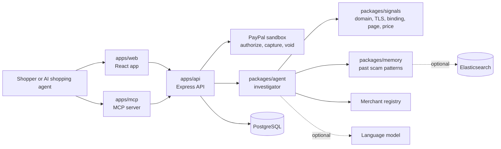

# TrustOra

TrustOra checks who is really getting paid before a PayPal payment is captured.

## For judges

Hosted demo: TO BE ADDED after deployment

**Sandbox buyer login:** TEAM TO ADD: PayPal sandbox buyer email and password for judges

You do not need an account to try it. The default run uses a built-in simulation of PayPal
(payment ids start with `SIM-`, every response says `simulated: true`). The sandbox buyer login
is only used if the API runs with real PayPal sandbox credentials and the web app has
`VITE_PAYPAL_CLIENT_ID` set, when the PayPal approval step appears (see `docs/paypal-sandbox.md`).

**Run it locally with no accounts (Node 22):**

```bash
npm ci && npm run build
npm start                 # API on http://localhost:3000
npm run dev:web           # in a second terminal: http://localhost:5173
```

To make the web app call the API instead of its built-in simulated backend, copy
`apps/web/.env.example` to `apps/web/.env` and set `VITE_API_URL=http://localhost:3000`
(badge: "Live API"). Details are in "Quick start" below.

**A 2-minute tour.** Open `/stores`, pick each of the three fictional stores, add the item and
check out. The expected results are:

| Store | What it is | Expected decision | Expected outcome |
| --- | --- | --- | --- |
| Harborline Outfitters | The genuine store | ALLOW | Captured |
| Bargain Barn Outlet | A heavy-discount store | WARN | Held until you acknowledge the warning, then captured |
| Harborlyne Outfitters Sale | An impersonator: it imitates the genuine brand but is paid to another account | PAUSE | Never captured; the authorization is voided on cancel |

These results are checked by `npm run test:e2e` (`apps/api/test/e2e.demo.test.ts`). `/analyst`
shows every investigation with its evidence. To watch an AI shopping agent do the same through the
MCP server, run `npm run demo:agent -- --auto-human yes` with the API running
(`docs/agentic-demo.md`).

## The problem

A shopper sees a checkout page that claims to be one merchant, but the PayPal account that
receives the money belongs to someone else. A fake outlet can copy a brand's look, undercut its
price and route the payment to a personal account. A fraud score on the page alone does not catch
that, and an AI shopping agent that reads the page can be talked into paying by text hidden in it.

TrustOra connects the two sides: the merchant the storefront **claims** to be, and the **actual
payee** on the PayPal order.

## How it works

1. **Authorize.** The API creates the PayPal order with intent `AUTHORIZE`, so the money is held
   rather than taken (`apps/api/src/controllers/frontendApi.controller.ts`).
2. **Investigate.** The investigator agent (`packages/agent`) gathers evidence: domain age and
   certificate, whether the site publishes its payee ("payee binding"), a lookalike check against
   known brands, price against comparable sellers, the registry record of the payee, how the
   claimed name compares with the registered name, and past scam patterns from memory.
3. **Decide.** Evidence is scored on four weighted buckets (domain 30, merchant identity 40,
   pricing 20, technical 10) and turned into a decision:

   | Score | Decision | Meaning |
   | --- | --- | --- |
   | 0 to 39 | ALLOW | Eligible for capture |
   | 40 to 74 | WARN | Held until a person confirms |
   | 75 to 100 | PAUSE | Capture is blocked |

   (`packages/agent/src/scoring/decide.ts`.)
4. **Capture or void.** In the web flow only an ALLOW reaches capture; WARN and PAUSE are held,
   and a held order can be cancelled, which voids the authorization. On the agent routes a person
   can approve a WARN, but the code never captures a PAUSE decision.

**Hard rules the language model cannot override** (`packages/agent/src/scoring/rules.ts`):

- The site publishes a merchant id that differs from the PayPal payee: score floor 75, so PAUSE.
- The domain imitates a known brand and the payee is not linked to that brand: score floor 75.
- Hidden text on the page tries to instruct an AI assistant: score floor 40.

Hard rules need deterministic evidence. Anything written by a language model can raise suspicion
but cannot reach PAUSE on its own, and page text is treated as untrusted data throughout. A
language model only writes plain-language explanations and helps compare names; every step has a
deterministic fallback.

## Architecture



## Repository layout

| Path | What it is |
| --- | --- |
| `apps/api` | Express API: PayPal orders, the demo routes the web app calls, the agent routes the MCP server calls, migrations |
| `apps/web` | React app: storefronts, checkout, the investigation view, analyst console |
| `apps/mcp` | MCP server with the tools `investigate_merchant`, `safe_checkout`, `set_spend_policy`, and a demo shopping agent |
| `packages/contracts` | Shared types and constants |
| `packages/agent` | Investigator agent: scoring, hard rules, identity matching, explanations, memory use |
| `packages/signals` | Evidence collectors and an in-process signals port for the agent |
| `packages/memory` | Anonymous memory of past scam patterns (in process, a persistent JSON file with Gemini embeddings, or Elasticsearch) |
| `packages/eval` | Benchmark and metrics |
| `demo-sites`, `tests`, `infra`, `scripts`, `docs` | Fictional demo notes, shared fixtures, deployment, repo checks, documentation |

## Quick start

You need Node 22.

```bash
npm ci
npm run build
```

### Demo mode (no accounts, no database)

```bash
# API: runs without PayPal credentials or a database (payments are simulated, data stays in memory)
npm start

# Web app, in a second terminal
cp apps/web/.env.example apps/web/.env
npm run dev:web      # http://localhost:5173
```

With `VITE_USE_MOCK` unset and no `VITE_API_URL`, the web app uses its built-in simulated
backend (badge: "Simulated backend"). Set `VITE_USE_MOCK=false` to call the API through the dev
proxy, or set `VITE_API_URL=http://localhost:3000` for a direct API URL (badge: "Live API").

Open `/stores` and buy from each of the three demo storefronts: the genuine one is captured, the
heavy-discount one is held until you acknowledge the warning, and the impersonator is paused.
`/analyst` is the analyst console. To watch an AI shopping agent do the same through the MCP server:

```bash
npm run demo:agent -- --auto-human yes     # needs the API running; no keys
```

See `docs/agentic-demo.md`.

### Modes

`GET /health` reports how the API runs:

| Mode | Values | Meaning |
| --- | --- | --- |
| `paypal` | `sandbox`, `simulated` | `sandbox` when `PAYPAL_CLIENT_ID` and `PAYPAL_CLIENT_SECRET` are set, otherwise payments are simulated and marked `simulated: true` |
| `store` | `database`, `memory` | PostgreSQL when `DATABASE_URL` is set and migrated, otherwise memory (a warning is logged) |
| `signals` (`SIGNALS_MODE`) | `replay`, `live`, `auto` | Recorded signals for the demo stores; live signals; or replay for the demo stores and live for any other domain |
| `llm` (`LLM_MODE`) | `live`, `replay`, `none` | A language model (needs `LLM_API_KEY` or `GEMINI_API_KEY`), recorded answers, or the agent's deterministic fallbacks |
| `memory` | `elastic`, `file`, `memory` | Elasticsearch when configured; otherwise a persistent JSON file in `.cache/`; in-memory in tests |

Every investigation also carries a `provenance` object with the signals, LLM provider/model, memory backend and embedding provider it used.
The API refuses to start if `PAYPAL_MODE` is anything but `sandbox`.

### With a database

```bash
cp .env.example .env     # set DATABASE_URL, then PAYPAL_CLIENT_ID and PAYPAL_CLIENT_SECRET for the sandbox
npm run migrate
npm start
```

Deployment on Render is described in `docs/deploy.md`. Using the real PayPal sandbox is described in
`docs/paypal-sandbox.md`.

### Audit privacy and encryption

Investigation JSON and payment-event detail are redacted before they are persisted. A buyer email
is stored only as a masked value, the expected sandbox payee email is stored only as a one-way
fingerprint, and known sensitive keys (phone, card, credentials) are replaced. Domains, evidence,
amounts and decisions remain available for the audit trail.

Set `AUDIT_ENCRYPTION_KEY` to a 32-byte key (64 hex characters) to encrypt both JSONB payloads
with AES-256-GCM. `GET /health` reports `modes.auditEncryption` as `enabled`, `disabled` or
`invalid`. Without the key, redaction still applies but the audit JSON is not encrypted. Generate
the key locally; never commit it:

```bash
node -e "console.log(require('crypto').randomBytes(32).toString('hex'))"
```

Existing plaintext rows remain readable. Encrypted rows require the same key. An optional
`AUDIT_HMAC_KEY` separates the payee-email fingerprint from the encryption key.

### External data sources and exact configuration

| Source | Configuration | Without it |
| --- | --- | --- |
| Kernel remote browser | `KERNEL_API_KEY` | The page is fetched over plain HTTP; JavaScript-heavy pages may be blocked or unavailable. |
| Channel3 catalogue | `CHANNEL3_API_KEY` | Price comparison is reported as `PRICE_UNKNOWN`; no comparison is invented. |
| Corporate registry | None wired. The API uses the local `merchant_records` table and `POST /api/merchants`. | Identity verification is limited to local records and official marketplace hostnames; missing records are disclosed. |
| Elasticsearch memory | `ELASTIC_URL`, `ELASTIC_API_KEY`, `ELASTIC_INDEX` | A persistent JSON file is used, or in-memory in tests. |
| Real PayPal JS approval | `VITE_PAYPAL_CLIENT_ID` in `apps/web/.env` plus sandbox API credentials | The checkout uses a clearly labelled simulated button. |

To use the real sandbox approval flow:

1. In the API `.env`, set `PAYPAL_MODE=sandbox`, `PAYPAL_CLIENT_ID`, `PAYPAL_CLIENT_SECRET`,
   `DATABASE_URL` and (recommended) `AUDIT_ENCRYPTION_KEY`.
2. In `apps/web/.env`, set `VITE_API_URL=http://127.0.0.1:3000` (or `VITE_USE_MOCK=false`) and
   `VITE_PAYPAL_CLIENT_ID` to the **public** sandbox client id.
3. Restart the API and web app. The PayPal SDK renders a real approval button; a sandbox buyer
   must approve the payment.
4. After approval the backend authorizes and applies ALLOW/WARN/PAUSE. Capture and void also
   require a valid authorization; no capture happens on a PAUSE or an unacknowledged WARN.

The client secret never reaches the browser and no credential belongs in chat or git.

## Environment variables

Names only; values never belong in the repository. See `.env.example` and `apps/web/.env.example`.

| Variable | Read in |
| --- | --- |
| `NODE_ENV`, `HOST`, `PORT`, `CORS_ORIGIN`, `RATE_LIMIT_WINDOW_MS`, `RATE_LIMIT_MAX` | `apps/api/src/config/env.ts` |
| `DATABASE_URL`, `DATABASE_SSL`, `DATABASE_TIMEOUT_MS`, `DATABASE_MAX_CONNECTIONS` | `apps/api/src/config/env.ts` |
| `AUDIT_ENCRYPTION_KEY`, `AUDIT_HMAC_KEY` | `apps/api/src/services/persistence/auditPrivacy.ts` |
| `PAYPAL_MODE`, `PAYPAL_CLIENT_ID`, `PAYPAL_CLIENT_SECRET`, `PAYPAL_TIMEOUT_MS` | `apps/api/src/config/env.ts` |
| `DEMO_ADMIN_TOKEN`, `GUARDIAN_API_KEY` | `apps/api/src/config/env.ts` |
| `STORE_GENUINE_PAYEE_EMAIL`, `STORE_GENUINE_PAYEE_MERCHANT_ID`, and the same for `DISCOUNT` and `IMPERSONATOR` | `apps/api/src/config/storeCatalog.ts` |
| `SIGNALS_MODE`, `LLM_MODE`, `LLM_API_KEY`, `GEMINI_API_KEY`, `LLM_BASE_URL`, `LLM_MODEL_FAST`, `LLM_MODEL_STRONG`, `LLM_FIXTURE_DIR`, `KERNEL_API_KEY`, `CHANNEL3_API_KEY`, `ELASTIC_URL`, `ELASTIC_API_KEY`, `ELASTIC_INDEX`, `MEMORY_MODE`, `MEMORY_FILE`, `GEMINI_EMBEDDING_MODEL` | `apps/api/src/services/agent/agentPorts.ts`; `packages/memory/src/patterns/embeddings.ts` |
| `AGENT_TIMEOUT_MS`, `AGENT_MODEL_BUDGET_MS`, `AGENT_MAX_FOLLOWUPS`, `AGENT_CONF_THRESHOLD`, `FEATURE_*`, `MEMORY_MATCH_MIN` | `packages/agent/src/config.ts` |
| `LLM_PROVIDER` | `packages/agent/src/config.ts` |
| `SIGNALS_BASE_URL`, `SIGNALS_FIXTURE_DIR` | `packages/agent/src/config.ts` |
| `ELASTIC_URL`, `ELASTIC_API_KEY`, `ELASTIC_INDEX`, `ELASTIC_INFERENCE_ID` | `packages/agent/src/config.ts`; `ELASTIC_NODE` also in `packages/memory/src/store/factory.ts` |
| `MCP_TRANSPORT`, `MCP_PORT`, `MCP_BEARER_TOKEN`, `GUARDIAN_API_URL`, `GUARDIAN_API_KEY`, `GUARDIAN_REQUEST_TIMEOUT_MS`, `GUARDIAN_FINALIZE_TIMEOUT_MS` | `apps/mcp/src/config.ts` |
| `CHANNEL3_API_KEY`, `CHANNEL3_BASE_URL`, `LLM_*` | `apps/mcp/demo-agent` |
| `VITE_API_URL`, `VITE_USE_MOCK` | `apps/web/src/api/apiClient.ts` (`VITE_USE_MOCK=false` forces the API; otherwise an API URL is needed to leave the simulator) |
| `VITE_PAYPAL_CLIENT_ID` | `apps/web/src/hooks/usePaypalAuth.ts` |
| `VITE_API_TARGET` | `apps/web/vite.config.ts` (local dev proxy) |

## Tests

| Command | What it runs |
| --- | --- |
| `npm run test:integration` | API tests with mocked PayPal (no network, no credentials) |
| `npm run test:e2e` | End-to-end API tests for the demo flow, the agent routes and the PayPal authorize, capture and void flow (fake `fetch`) |
| `npm run test:packages` | Agent, MCP, signals, memory and eval package tests |
| `npm run test:contracts` | Contracts type check and fixture validation |
| `npm run test:agent` | Investigator agent |
| `npm run test:mcp` | MCP server |
| `npm test -w @checkout-guardian/signals` | Signals package (also `-w @checkout-guardian/memory`, `-w @checkout-guardian/eval`) |
| `npm run test:sandbox` | Real PayPal sandbox calls. Needs credentials; skips without them |
| `npm run check:brands`, `npm run check:hygiene` | Fictional-brand guard and repository checks |
| `npm run lint`, `npm run typecheck` | Lint and type check |

## Evaluation

`npm run eval -w @checkout-guardian/eval` compares two baselines with the full agent on a
labelled benchmark and writes `docs/eval-results.md`. It is a small synthetic benchmark written by
the team, not a claim about real-world accuracy.

## What is real and what is simulated

| Part | Real | Simulated or not yet live |
| --- | --- | --- |
| API, validation, tokens, spend policies, audit trail | Yes | |
| Investigator agent (scoring, hard rules, identity, explanations) | Yes: runs on every scan, order and agent route | |
| Signals for the three demo stores | | Recorded (`SIGNALS_MODE=replay` or `auto`) |
| Signals for any other domain | Live RDAP, TLS and payee-binding checks in `live` or `auto` mode (Kernel and Channel3 with keys) | Not cleared without evidence in `replay` mode |
| Payments | PayPal sandbox calls when sandbox credentials are set | Simulated otherwise: `SIM-` ids and `simulated: true` |
| Language model | Live Gemini 3.5 Flash structured JSON, validated through Zod, with model fallback and a hard timeout | `replay` has no committed recordings yet; deterministic fallbacks remain when the model is unavailable |
| Memory | Persistent JSON file with Gemini embeddings; Elasticsearch when configured | In-memory in tests; the demo stores are not written to memory |
| Persistence | PostgreSQL when `DATABASE_URL` is set | Memory otherwise |
| Web app | Calls the API when `VITE_USE_MOCK=false` or `VITE_API_URL` is set | Built-in simulated backend otherwise |

Only an ALLOW is captured. A WARN waits for a person to acknowledge it. A PAUSE, and any payee
mismatch, is never captured. The defects that remain are listed in `docs/e2e-report.md`.

## Known limitations

Be clear about what has not been run live. These parts are written and tested against fakes, but
**have not been run against the real service from this repository**:

- PayPal sandbox authorize, capture and void (mock-tested). Real sandbox OAuth, order creation and retrieval were verified; authorize/capture need a buyer approval that is not automated here.
- Kernel remote browser and Channel3 catalogue (tested with fake clients).
- Recorded model answers (`LLM_MODE=replay`; none are committed).
- Elasticsearch scam memory (tested with a fake `fetch`; the live test skips without credentials). The file-backed memory and Gemini embeddings are verified live.
- A hosted persistent memory disk. The local JSON file survives restarts, but a container filesystem may not; use a mounted disk or Elasticsearch in a hosted deployment.
- Live Kernel browser and Channel3 catalogue signals (their keys are not configured in this environment). RDAP, TLS, page metadata and structured product data are live.
- PostgreSQL migrations 001–003 were applied locally and `/health` reports the database store; the automated migration test still uses a mock pool.
- The web app in a browser (it builds and type-checks; routes verified locally at `http://localhost:5173`).
- Latency under 2 seconds for a live scan. Not shown. Measured on one machine (`docs/latency.md`): with
  recorded signals and no model, every request to the three demo stores took under 150 ms. An
  earlier local run of live scans took 1.7 to 3.7 seconds (not reproduced by the committed script),
  and one live ambiguous scan took 7.08 seconds. `AGENT_MODEL_BUDGET_MS` (default 1200) now caps the
  total model time per scan and falls back to deterministic output when it runs out; with a
  simulated 700 ms model it kept warm scans under 2 seconds. A real model and the hosted instance
  were not measured. The free Render instance sleeps after about 15 minutes, so the first request
  to the hosted demo is cold and slow.
- A populated favicon reference corpus. The comparison code exists (`docs/favicon-references.md`)
  and is tested with fakes, but `packages/signals/data/favicon-references.json` is empty because
  the invented demo stores have no favicon asset. Without a reference, `FAVICON_MISMATCH` is never
  emitted. A third-party CDN is not treated as fraud.
- Registrar reputation. The RDAP collector extracts the registrar name and registration date.
  No reputation source exists, so registrar reputation is reported as `not_assessed`
  (`signalAvailability.registrarReputation`) and the registrar name never changes the score.
- An external corporate-registry provider. The local `merchant_records` table is the configured
  identity source; no commercial registry adapter is present.

Other limits: the evaluation is a small synthetic benchmark; retrieved similar cases are passed to
the explanation writer only as context and can never change the deterministic decision; PayPal
webhooks are not handled.

## PayPal capabilities used

The PayPal calls are in `apps/api/src/services/paypal` and are called in order by
`apps/api/src/services/payments/paymentFlow.service.ts`. Sandbox only: the API refuses to start if
`PAYPAL_MODE` is not `sandbox` (`apps/api/src/config/env.ts`).

| Capability | Endpoint | Where |
| --- | --- | --- |
| OAuth 2.0 client credentials | `POST /v1/oauth2/token` | `paypalAuth.service.ts` |
| Orders v2: create (intent `AUTHORIZE`) | `POST /v2/checkout/orders` | `createPayPalOrder` |
| Orders v2: authorize | `POST /v2/checkout/orders/{id}/authorize` | `authorizePayPalOrder` |
| Payments v2: capture an authorization | `POST /v2/payments/authorizations/{id}/capture` | `capturePayPalAuthorization` |
| Payments v2: void an authorization | `POST /v2/payments/authorizations/{id}/void` | `voidPayPalAuthorization` |

Create, authorize, capture and void send a `PayPal-Request-Id` header. The service also has
helpers to read an order and to capture an order directly; the checkout flow does not use them.
The web app loads the PayPal JavaScript SDK with `intent=authorize` when `VITE_PAYPAL_CLIENT_ID`
is set (`apps/web/src/hooks/usePaypalAuth.ts`). None of this has been run against the real
sandbox from this repository (see "Known limitations").

AI coding and development tools used while building TrustOra:

| Tool | Used for |
| --- | --- |
| Antigravity (Google DeepMind AI coding assistant) | Backend and integration work |
| GitHub Copilot | Inline code completion during development |
| ChatGPT / GPT-4o | Research, prompt design for the LLM investigation step, and architecture brainstorming |

TEAM TO COMPLETE: add the tools the other team members used and what each was used for.

## Judging criteria

How TrustOra addresses the five official criteria. Nothing below has been run against live
services unless it says so.

| Criterion | How TrustOra addresses it | Where |
| --- | --- | --- |
| Technological Implementation | Uses the PayPal Orders and Payments APIs to authorize, then capture or void, with idempotency headers and a refusal to run outside the sandbox. The investigator agent decides from deterministic evidence; a language model is optional and cannot override hard rules. Spend policies, order tokens, validation, an audit trail and an MCP server are implemented and tested with fakes. Not yet run against live PayPal or a live model | `apps/api/src/services/paypal`, `apps/api/src/services/payments/paymentFlow.service.ts`, `packages/agent/src/scoring/rules.ts`, `apps/mcp`, `apps/api/test/e2e.demo.test.ts` |
| Design | A storefront, checkout, an investigation view with evidence cards and provenance chips, a pay screen with the capture state and a warning acknowledgement, and an analyst console. The web app has been built, type-checked and verified locally at `http://localhost:5173` | `apps/web/src/pages`, `apps/web/src/components/Provenance.tsx` |
| Potential Impact | Targets one specific problem: the merchant a checkout claims to be differs from the account that is paid, and AI shopping agents can be misled by page text. Aimed at shoppers, and at agents that pay for them. No user research or usage numbers exist yet | "The problem" above, `packages/agent/src/scoring/rules.ts`, `packages/agent/src/guard` |
| Innovation/Idea | Ties the claimed merchant to the actual PayPal payee before capture, using AUTHORIZE so a payment can be voided; treats merchant page text as untrusted data; gives AI agents guarded checkout tools through MCP; keeps an anonymous memory of past scam patterns | `packages/agent`, `apps/mcp`, `packages/memory` |
| Presentation | See the demo video (link to be added) | TO BE ADDED |

## Hackathon requirements

| Requirement | Where it is met | Status |
| --- | --- | --- |
| Meaningfully integrate PayPal (free sandbox) | OAuth, Orders v2 create and authorize, authorization capture and void (see "PayPal capabilities used") | OAuth and order create/retrieve verified live; capture/void need buyer approval and are mock-tested |
| Meaningfully incorporate AI | The investigator agent (`packages/agent`); live Gemini structured explanations and pattern analysis with validation; MCP tools for AI shopping agents; persistent RAG memory with Gemini embeddings | Deterministic agent and live Gemini verified; file-backed RAG persistence and retrieval verified |
| Working prototype | The local run in "For judges"; `npm run test:e2e`; `docs/agentic-demo.md` | Runs in simulation. Hosted demo not deployed |
| Documentation for judges | This README and `docs/` (sandbox, deploy, agentic demo, e2e report, eval results) | Done; placeholders marked |
| Functional demo (hosted URL or clear run instructions) | "For judges" and "Quick start"; `render.yaml` and `docs/deploy.md` for hosting | Run instructions: done. Hosted URL: TO BE ADDED after deployment |
| Tools used, and how | "AI tools and services used" below | Runtime tools: documented. Development tools: TEAM TO COMPLETE |
| Public, open source repository with the license visible in the About section | `LICENSE` (MIT) is in the repository | TEAM TO CONFIRM on GitHub (visibility and the About section) |
| Demo video under 3 minutes on YouTube, no third-party trademarks or copyrighted music | Demo content uses invented brands only (`npm run check:brands`) | Video not made yet; link to be added |
| Built during the contest period (existing projects need meaningful progress) | See "Built during the contest period" below | TEAM TO CONFIRM |

The deadline on the Devpost page is 13 Nov 2026, 1:30 am GMT+5:30.

## AI tools and services used

| Tool or service | How it is used | Where | Status |
| --- | --- | --- | --- |
| Language model, through an OpenAI-compatible HTTP provider (`LLM_PROVIDER`, `LLM_BASE_URL`, `LLM_MODEL_FAST`, `LLM_MODEL_STRONG`) | Follow-up investigation steps, name comparison, a read of promotional and pressure wording (`docs/promotional-language.md`), the memory pattern sentence, retrieved-case relevance, the plain-language explanation | `packages/agent/src/llm`, `packages/agent/src/config.ts`, `apps/api/src/services/agent/agentPorts.ts` | Live Gemini 3.5 Flash verified with real structured JSON; deterministic fallbacks remain; no recordings committed |
| Investigator agent (deterministic scoring, hard rules, identity matching, explanation checks) | Decides ALLOW, WARN or PAUSE on every scan, order and agent route | `packages/agent` | Runs in the default mode. It is rule-based; the language model only helps as described above |
| Elasticsearch (`semantic_text`) | Scam-pattern memory | `packages/agent/src/adapters/memoryElastic.ts`, `packages/memory/src/patterns/elasticPatternStore.ts` | Optional (`ELASTIC_URL`, `ELASTIC_API_KEY`); in-memory store otherwise. Tested with fakes; not yet run live |
| Kernel remote browser | Loads the checkout page for live signals | `packages/signals/src/agentPort/kernelClient.ts` | Optional (`KERNEL_API_KEY`). Tested with fakes; not yet run live |
| Channel3 catalogue (`@channel3/sdk`) | Price comparison for live signals; market context for the demo shopper | `packages/signals/src/agentPort/channel3Client.ts`, `apps/mcp/demo-agent/marketplace.ts` | Optional (`CHANNEL3_API_KEY`), with a fixture fallback. Tested with fakes; not yet run live |
| MCP server | Lets an AI shopping agent call `investigate_merchant`, `safe_checkout` and `set_spend_policy` | `apps/mcp` | Tested; the scripted demo shopper runs against the API with no keys. A live-model shopper has not been run |

**TEAM TO COMPLETE: list any AI coding or design tools used to build the project and what each was used for (recommended disclosure).**

## Sponsor technologies

Using sponsor tools is optional. This section only says what the code does; it makes no claim
about prize eligibility.

| Technology | How it is used | Run live? |
| --- | --- | --- |
| Elastic | Optional semantic scam-pattern memory (`semantic_text`) in `packages/memory` and `packages/agent/src/adapters/memoryElastic.ts`. Without credentials a persistent JSON file with Gemini embeddings is used | No. Tested with a fake `fetch`; the live test skips without credentials |
| Kernel | Remote browser that loads the checkout page for live signals (`packages/signals/src/agentPort/kernelClient.ts`), only with `SIGNALS_MODE` set to `live` or `auto` and a key | No. Tested with fake clients |
| Channel3 | Product catalogue used for price comparison in live signals and for market context in the demo shopper | No. Tested with fake clients |
| Render | `render.yaml` describes the API and web services; `docs/deploy.md` and `npm run smoke:deploy` cover deployment | No. Nothing has been deployed |
| AG Grid | The investigations table in the analyst console: sorting, filters and CSV export (`apps/web/src/pages/AnalystConsole.tsx`, Community edition) | Builds, type-checks and loads locally at `/analyst` |

## Built during the contest period

The first commit in this repository is dated 2026-10-31 (from `git log`). The contest start date
is not recorded in this repository, so it is not stated here. TEAM TO CONFIRM against the contest
dates on the Devpost page, and note anything that existed before the contest.

## Fictional brands

Every store, brand, logo and domain in demos, fixtures and docs is invented, and demo domains use
the `.example` suffix. The hackathon bans third-party trademarks in the demo video.
`npm run check:brands` scans demo content for a list of real brand names and runs in CI.

## License

MIT. See `LICENSE`.
